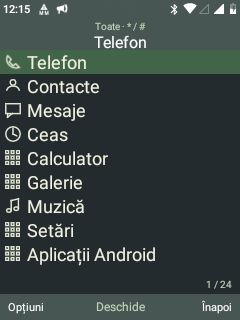
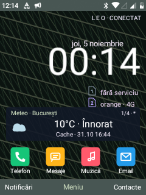

# Sxmo-inspired Leo theme

`Sxmo · Pine` is an optional native Leo visual pack inspired by the supplied Bananarchy/Sxmo screenshots. It retains Android and the existing Leo applications, keypad actions and Home editor.

- Charcoal background, grey-green bars and a flat green selection.
- Nine compact launcher rows with original monochrome line glyphs.
- Compact shared application lists with square selection surfaces.
- Larger Home clock, with its background panel removed; saved Home item positions are preserved.
- Original procedural pine-needle wallpaper; no Reddit artwork is bundled.
- Existing theme checkpoint restores the preceding visual settings, list preference and wallpaper.

Once installed, open Leo visual collections, select Sxmo · Pine and choose the complete pack, or apply only its colours. The complete pack selects list navigation and the Pine wallpaper. Other packs and accessibility high contrast remain available.

This is a first visual pass. Custom player, calculator and other bespoke canvases retain their own layouts. It does not replace Android SystemUI or run the Sxmo Linux shell.

## Validation on Nokia 6300

The theme was installed and activated successfully. Sixteen isolated on-device checks passed for palette registration, selection colours, list mode, wallpaper decoding, eight visible glyphs and exact restoration of the preceding fixture settings and wallpaper. These checks used separate preferences and temporary files; activation then used the standard theme checkpoint.

Home and the launcher menu were inspected from device screenshots. The active APK and system base match; the system partition was remounted read-only. Existing Home item positions were preserved, so the Home screenshot reflects the owner's arrangement rather than a reset to the reference screenshot.

WSL remains unavailable with an HCS connection timeout. This candidate was compiled using portable Windows JDK 8 and Android SDK tools: the nine changed visual classes were recompiled against the existing project class archive, the remaining compiled project classes and 59 existing dependency classes were retained, and the APK was signed with the existing AOSP test certificate. All original non-code APK entries were checked byte-for-byte. This was an incremental build, not a full AOSP ROM rebuild. The normal source build remains `build-visual-shell.sh` when WSL is available again.

