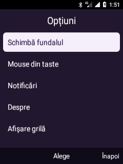

# Leo Visual — primul prototip de interfață

**19 octombrie 2026.** `ro.leo.visual` este acum interfața HOME implicită,
inspirată de navigarea KaiOS. La cererea utilizatorului, Leo clasic a fost
dezinstalat pentru utilizatorul Android activ, iar opțiunea lui a fost eliminată
din meniu. Nu sunt înlocuite serviciile de telefonie sau imaginile boot/recovery.

## HOME, notificări și cursor din taste

### Listă, grilă și preferințe

Meniul Opțiuni folosește acum componenta nativă reutilizabilă `KeypadDialog`:
focus vizibil, sus/jos pentru deplasare, OK pentru alegere și Înapoi pentru anulare.
Bara inferioară indică permanent „Alege / Înapoi”. Meniul este desenat pentru
240×320, fără animații și fără WebView. Dialogurile informative și meniul global
de accesibilitate păstrează momentan implementările anterioare.

Verificare pe telefon: captură reală inspectată, deschidere/închidere din taste,
Calculator și revenire, notificări și rezolvarea HOME. Alegerea listă/grilă din
noul meniu a fost verificată prin preferința salvată. Nu s-a efectuat un reboot.

Din Opțiuni se poate alege **Afișare listă / Afișare grilă**. Lista afișează până
la cinci rânduri și se parcurge cu sus/jos. Alegerea și culoarea fundalului sunt
salvate în preferințe private. Persistența listei a fost verificată după oprirea
și relansarea procesului; Calculatorul s-a deschis din lista navigată cu tastele.
Nu s-a efectuat un reboot nou pentru acest test.

Planul comun al interfeței și aplicațiilor: [PROJECT.md](PROJECT.md).

- Soft stânga din prima pagină deschide panoul real de notificări Android.
- Tasta **Meniu dedicată** deschide global „Meniu Leo”: Notificări, Mouse din
  taste / Oprește mouse-ul, Acasă și Închide. Funcționează și peste alte aplicații.
- Scan code 212 identifică tasta Meniu, separat de soft stânga (139). În meniu,
  D-pad și OK navighează normal, inclusiv dacă mouse-ul era pornit.
- Soft dreapta din prima pagină deschide Contacte; în grilă revine la Home.
- În grilă: soft stânga → **Mouse din taste** activează cursorul global.
- În modul mouse: săgeți = deplasare, OK = clic, `#` = oprire.
- `*` comută între deplasare și derulare; în derulare, sus/jos injectează un swipe.
- Tasta roșie, când nu există un apel, revine în Leo Visual. În apel păstrează
  politica Android de închidere a apelului.

Serviciul de accesibilitate solicită filtrarea tastelor și injectarea gesturilor;
nu solicită citirea conținutului ferestrelor. Folosește un overlay de accesibilitate,
nu permisiunea generală de desenare peste aplicații. Când modul este oprit,
serviciul nu consumă tastele. Activarea nu se reia automat după restartul serviciului.

`activate-visual-home.py` salvează setările anterioare local, păstrează celelalte
servicii de accesibilitate activate și setează HOME. Actualizează doar selecția
shell-ului din scriptul de configurare existent. Când Leo Visual este instalat,
îl selectează la boot; altfel lasă Android să rezolve un HOME disponibil, fără
referință la Leo clasic. Scriptul `/system` a fost instalat
atomic și sistemul remontat read-only. Alegerea pentru următorul boot este
configurată; nu s-a efectuat un reboot nou pentru această verificare.

Verificări noi: rezolvarea HOME indică Leo Visual; scan code 107 a revenit din
Leo clasic în noul HOME cu ambele SIM-uri în repaus. Panoul de notificări a primit
focusul `StatusBar`. În ecranul privat `PointerTestActivity`, OK injectat la nivel
de tastatură a produs atât `clicks=1`, cât și confirmarea gestului de accesibilitate.
Mișcările cursorului au fost observate în jurnal. Derularea și compatibilitatea
cu toate aplicațiile nu sunt încă validate. Captura de clic nu conține notificări
sau date personale.

Meniul global a fost verificat prin scan code 212 din Calculator, cu captură
„Meniu Leo”. Alegerea Notificări a transferat focusul la `StatusBar`.
Dezinstalarea `ro.leo.shell` pentru utilizatorul 0 a returnat Success; lista
pachetelor instalate pentru acel utilizator nu îl mai conține, iar HOME se
rezolvă în continuare la `ro.leo.visual/.MainActivity`. Fiind anterior o aplicație
de sistem actualizată, această dezinstalare nu șterge APK-ul de bază din imaginea
system. Împachetarea viitoare include Leo Visual în locul LeoShell; nu s-a generat
sau scris o imagine nouă în această probă.

| Meniu global peste Calculator | Clic prin cursor în ecranul de test |
| --- | --- |
|  |  |

## Implementat

- Home cu ceas, dată în română, fundal vectorial și două variante de culori.
- Două rânduri SIM: operator și stare citite separat pentru fiecare slot.
- Grilă 3×3: Telefon, Contacte, Mesaje, Ceas, Calculator, Galerie, Muzică, Fișiere, Setări.
- Selecție din D-pad, etichete pentru tastele soft și opțiuni native.
- Lansarea aplicațiilor Android instalate; mesaj „indisponibil” dacă nu există o țintă.
- Desenare nativă Canvas; iconuri și fundal originale, fără resurse copiate din KaiOS.
- Actualizare la schimbarea stării telefoniei, la revenirea în aplicație și la minut pentru ceas. Fără animație sau buclă continuă de randare.

Acesta este un prototip de shell, nu portarea tuturor aplicațiilor KaiOS. Tile-ul
Mesaje nu instalează o aplicație SMS. Aplicațiile Android lansate își păstrează
interfețele existente și nu devin automat adaptate complet la taste.

## Comenzi

| Tastă | Home | Grila de aplicații |
| --- | --- | --- |
| OK | Deschide grila | Deschide aplicația selectată |
| Săgeți | Deschide grila | Deplasează selecția, cu limite la margini |
| Soft stânga / Meniu | Notificări | Opțiuni |
| Soft dreapta / Înapoi | Contacte | Revine la Home |
| Verde | Deschide Dialer, fără a efectua un apel | La fel |
| 1–9 | Fără acțiune specială | Selectează tile-ul corespunzător; OK îl deschide |
| Roșu | Politica Android ENDCALL; revine în Leo Visual în repaus | La fel |

Opțiunile din grilă includ schimbarea fundalului, mouse, notificări și explicația comenzilor.
În timpul unui apel, tasta roșie păstrează comportamentul global de închidere a
apelului. Prototipul nu interceptează această tastă.

## Starea ambelor SIM-uri

Folosește `SubscriptionManager`, câte un `TelephonyManager` pentru fiecare
abonament și `ServiceState`, cu permisiunea Android `READ_PHONE_STATE`.
Nu citește numerele de telefon, IMSI sau ICCID și nu le salvează în jurnal.
Permisiunea este folosită doar pentru citirea stării, nu pentru modificarea rețelei.

Captura verificată arată **SIM 1: Vodafone RO · 4G** și **SIM 2: DIGI RO · conectat**.
„Conectat” descrie înregistrarea în serviciu, nu o probă de internet. Eticheta 4G
provine din tehnologia de date raportată de Android; nu confirmă trafic activ sau VoLTE.
Sunt prevăzute și stări pentru SIM lipsă, PIN/PUK necesar, fără serviciu și radio oprit.
Aceste stări alternative nu au fost provocate fizic în această probă.

## Validare pe telefon

Pachetul s-a compilat și instalat. Au fost inspectate capturile Home și grilă,
inclusiv ambele rânduri SIM. Scriptul de probă a verificat:

- Deschiderea grilei cu OK și selecția Calculatorului prin D-pad.
- Lansarea Calculatorului instalat și revenirea în prototip prin Înapoi.
- Revenirea din grilă la Home și deschiderea/închiderea opțiunilor.
- Inițial, păstrarea `ro.leo.shell` ca HOME; ulterior, selectarea Leo Visual, descrisă mai sus. Nu au fost efectuate apeluri în aceste probe.

O primă probă a fost întreruptă de pierderea conexiunii și repornirea telefonului,
nesolicitată de aceste scripturi. Proba completă a trecut după revenirea sistemului.
Nu atribuim repornirea prototipului și nici nu o considerăm rezolvată prin acest test.

Nu au fost verificate toate cele nouă lansări, consumul de baterie, latența față
de Leo sau funcționarea completă a fiecărei aplicații deschise. Nu au fost
înlocuite serviciile Android sau rescrise partițiile boot/recovery.

| Home cu două SIM-uri | Grila 3×3 |
| --- | --- |
|  |  |

## Compilare și instalare în mediul proiectului

Surse: `visual-shell/`, inclusiv serviciul de accesibilitate, resursa XML și ecranul privat de test.
În WSL rulează `build-visual-shell.sh`; rezultatul este APK-ul local ignorat
`output/leo-visual.apk`. Folosește un director nou de compilare pentru a evita
clase rămase din build-uri precedente. Arborele AOSP și Java 8 trebuie pregătite.

Instalarea folosește fluxul existent ADB + `framework-command.py`: transfer APK,
`pm install -r`, apoi `pm grant ro.leo.visual android.permission.READ_PHONE_STATE`.
`activate-visual-home.py` aplică selecția HOME și activarea serviciului de cursor.
Se poate lansa și explicit `ro.leo.visual/.MainActivity`. Permisiunea a fost acordată
prin ADB pentru a evita un dialog tactil pe telefonul cu taste.

`verify-visual-shell.py` păstrează capturi locale în `output/visual-shell-test/`
și verifică lansarea Calculatorului fără a apela numere. Nu este o probă de
compatibilitate pentru toate aplicațiile KaiOS.
