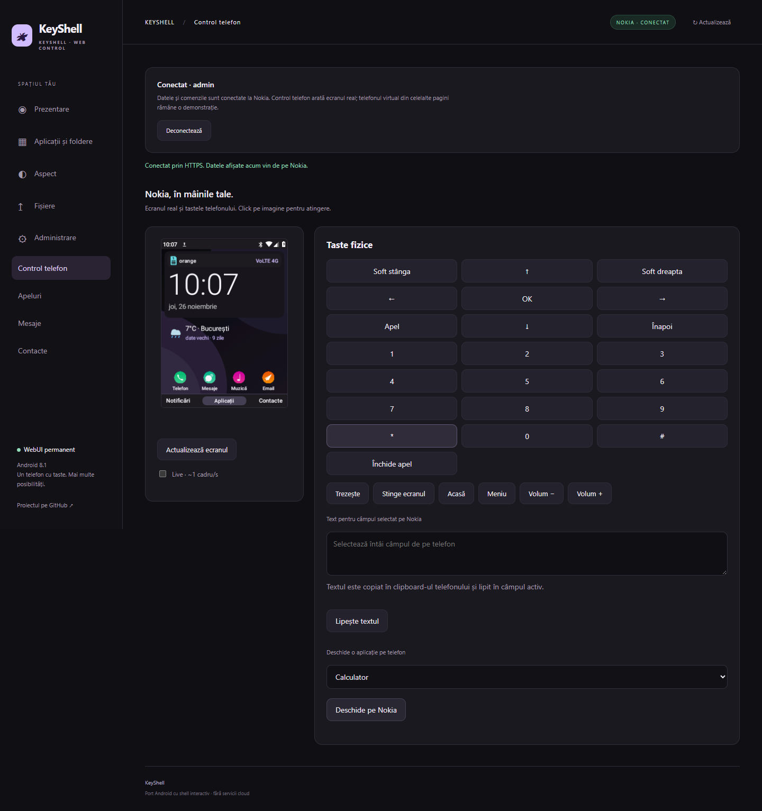

# KeyShell · browser control · 26 November 2026

Historical bring-up record. [Current 27 November WebUI](WEBUI.md) removes the
offline preview and adds the faster handset control path.

The persistent [password WebUI](WEBUI.md) now controls the real Nokia through
four additional pages. Its virtual phone preview remains a separate demo.
Existing accounts, certificate, Wi-Fi port and saved launcher IDs are preserved.



The frame above comes from the physical handset. Message/contact design images in
the README use synthetic data, so private correspondence is not published.

## On the phone and in the browser

Open **Applications → Advanced → WebUI → Features** and enable **Screen and remote
keys** and **Calls, messages and contacts**. Administrators can also control these
switches under browser **Administrare**. New installations default these two
capabilities to off. Both are enabled on the project handset at the owner's request.
Read-only accounts cannot access the screen, private communications or remote input.
The communications switch gates the dedicated data/action APIs. Full screen/keypad
control still grants whatever actions are available through the phone's own UI;
it is not an application sandbox.

| Browser page | Functions |
| --- | --- |
| **Control telefon** | Real 240 × 320 PNG, manual refresh or opt-in ~1 frame/s; D-pad/OK/digits, distinct softkeys, Back/Menu/Home, Call/End, volume, wake/sleep; click-to-tap; Unicode paste; launch visible shell apps |
| **Apeluri** | Explicit SIM choice, destination preview/confirmation, active-call state, answer/hang up, hold/resume, speaker/receiver, mute and DTMF; recent 100-call history |
| **Mesaje** | Recent 200 messages from Android/private archives, search, reply form, explicit SIM, encoding-aware segment count and final confirmation; shared native send/delivery status |
| **Contacte** | First 300 phone numbers, name/number search; choosing Call/SMS fills its form without transmitting |

**Call audio stays on Nokia**, including when the call is initiated from the
browser. This release does not carry cellular audio to a PC microphone/headset.
Active-call actions require KeyShell to be the default dialer, as on the reference
handset. The keypad/screen route can navigate other installed Android apps through
the existing launcher/settings pages. Remote input uses the port's existing
restricted-UID root helper; it is not a generic stock-Android capability.

When the display is asleep, a frame can be black. **Trezește** wakes it; use
**OK → \*** or **soft left → \*** if the keypad lock is active. Reading a frame
does not keep the phone awake. Text paste uses Android clipboard to preserve
Romanian characters and remains in that clipboard until replaced. The page says
this beside the editor; it never sends clipboard contents back to the PC.

## Confirmation and privacy boundaries

Calling and sending SMS follow **prepare → confirm**. Preparation validates the
number, selected physical SIM, account or SMS segmentation, then returns a random
ticket bound to that authenticated browser session. It expires after 60 seconds,
is consumed before dispatch and cannot be replayed, including after an ambiguous
transport error. SIM/subscription/account identity is checked again at confirmation.
There is no automatic retry. Browser Cancel never dispatches the prepared action.

The native and browser SMS paths share `SmsSender`: one durable pending send,
native multipart sent/delivery callbacks and the existing `SmsStore` archive.
The remote composer accepts at most 1,600 characters/10 segments. A queued send
is not a delivery confirmation. An outstanding send blocks another send rather
than silently repeating it. Native draft/preview and delivery behavior remain.

All private routes are password-authenticated, administrator-only and checked
against their feature switch on every request. The fixed input API accepts named
keys, bounded display coordinates, text or a catalog ID; client text cannot become
a shell command, executable, filesystem path or arbitrary Intent. Softkey injection
preserves physical scans **139/158**, while dedicated Menu uses **212**.

Frames are fetched with the in-memory Authorization header and displayed through
revocable Blob URLs. There are no token-bearing image URLs, recordings, frame
files, service workers or private browser-storage copies. Disconnect clears
private lists/forms and releases frames. Frame polling is opt-in and stops when
the tab/page is hidden; current-call polling runs only while its page is visible.
The server caps frame requests to one per 700 ms and keeps its existing bounded
two-worker pool. No production wake lock was added.

## Fresh checks

- **48 device checks** on TA-1286/API 27: authentication/feature gates, viewer
  rejection, invalid key/coordinate/app/payload rejection, actual PNG capture,
  Unicode paste into a controlled Android editor, physical right-softkey deletion
  exactly once, native app launch/Back/Home and private phone-state structure. App
  launching enters through KeyShell's private Home route, preserving normal Back
  behavior. A first physical smoke reached the older separate Calculator task
  when leaving Settings; after correcting the launch route and removing that
  empty test task, the complete physical smoke passed. Prepared calls
  and SMS used a **fake transport**, proving session binding, cancellation-by-no-
  confirmation, expiry, one-use dispatch, replay protection after failure and
  server-stop cleanup **without calling or sending**.
- **22 synthetic Edge checks**: confirmations/cancel, SIM/destination/body preview,
  contacts/search/form handoff, literal HTML-like message/contact text, named-key
  and Unicode requests, memory cleanup on logout, viewer restrictions and mobile
  overflow. Public design screenshots use synthetic API data and a previously
  published stopped-control frame; they are not evidence of live calls/messages.
- **Real Wi-Fi browser smoke**: the PC used the handset's installed HTTPS service,
  pinned its certificate on every connection, signed in with the owner's account,
  rendered a 240 × 320 Blob under the real CSP, launched Calculator, and loaded
  phone state/history/messages/contacts. Private rows were not exported. No call
  or SMS was sent. The first frame with a sleeping display was black; waking the
  display is an explicit control rather than an idle wake lock.
- **160 native Messages preview checks**, **107 host tests**, catalog/manifest and
  APK dependency audits pass. All five standard physical keypad routes pass.
  The build compiles **309 production Java sources**, with **2,320 classes** and
  all 431 baseline external classes preserved.

Cellular call establishment, remote answer/audio/DTMF and actual SMS delivery
through these new browser pages still need an authorized live peer/destination.
The earlier [keySIP extension-200 trial](KEYSHELL-NETWORK-SIP.md#keysip-follow-up--25-november-2026)
is separate evidence, not a cellular browser-call test. Long uptime, concurrent
administrators, battery/deep-sleep reachability and further routers remain trials.

Installed data APK SHA-256:
`d4eb31fd33adc521a01b5a5f1f8884bbc492ee55e84537c07e4ff6462c1aa4df`.
Bundled system base remains
`abcb93b6ee1305ededb7e52105a2d5dc232f8c795e67420834e49564cb89f0e6`.
No system promotion, ROM flash or reboot was performed.

## Reproduce

```text
python android81/build-pocket-apps-windows.py
python android81/build-pocket-tests-windows.py --webui-control
python android81/test-webui-control-browser.py
python android81/test-webui-browser.py
python -m unittest discover -s android81/tests -q
```

The device runner is `ro.leo.visual.webuicontrolchecks/ro.leo.visual.WebUiControlTests`.
It isolates settings/databases and never dispatches real calls/SMS. Only the
explicit `-e enable_control true` option enables the owner's new feature switches;
the runner requests restoration of the owner's service. After Android finishes
instrumentation, reopen Home and verify the foreground service; instrumentation
can terminate the target process, unlike ordinary page closure.
`test-webui-handset.py --identity PRIVATE.json --exercise-controls` accepts the
password on stdin, pins each connection, launches only Calculator and retains its
private screen/report under ignored `output/webui-remote/`. It does not transmit.

The phone actions use Android's existing
[TelecomManager.placeCall](https://developer.android.com/reference/android/telecom/TelecomManager#placeCall(android.net.Uri,%20android.os.Bundle))
and [SmsManager multipart transport/callbacks](https://developer.android.com/reference/android/telephony/SmsManager).
Android continues to own cellular connections and message delivery.
