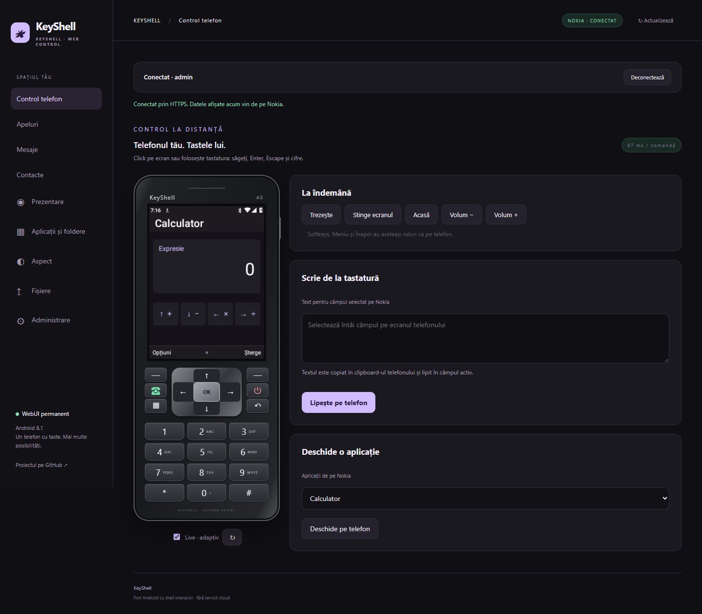

# KeyShell · faster handset control · 27 November 2026

WebUI now opens the real phone controller inside a keypad handset. The offline
simulator, synthetic startup statistics, virtual application screens, local-demo
server and packaged sample catalog have been removed. Before sign-in there are
empty status fields and a connection form. After sign-in the catalog, themes,
folders and status come from the phone's authenticated API.



The frame and keys are functional HTML/CSS. The screen is the handset's actual
240 × 320 image. D-pad, both softkeys, dedicated Menu/Back, digits and green/red
controls send phone input; they are not a rendered navigation simulation.

[Real mobile-browser capture](screenshots/webui-fast-2026-11-27/mobile.png).

## Measured change

Same TA-1286/API 27, same Wi-Fi endpoint/certificate, eight harmless Up-key and
screen requests per run. Numbers measure request-to-response after establishing
each pinned TLS connection; they exclude login, the TLS handshake, cold helper
startup and PC/LCD rendering. The before image uses the previous APK `5885a7d`.

| Median | Before | After | Change |
| --- | ---: | ---: | ---: |
| Key receipt | 1,427.0 ms | 42.2 ms | about **34× faster** |
| Screen request | 743.3 ms | 105.7 ms | about **7× faster** |
| Extra browser delay after each key | 750 ms | 0 ms | removed |

The after run includes one 329.5-ms key sample and one 197.9-ms frame sample;
these are included in the medians. These timings describe the measured active
session, not a guaranteed latency on every router or after deep sleep. Raw
sanitized samples remain under ignored `output/webui-fast/`.

The old run completed all timed requests but its final logout response was
truncated. Logout now consumes/validates an optional empty JSON body before
replying, and small HTTPS replies are buffered together. The new timing and
browser runs completed logout normally. The earlier failure is not counted as
a fully passing old benchmark.

## Input and capture path

- The browser retains rapid presses in a bounded FIFO, independent of image
  refresh. It does not silently ignore keys while a frame is loading. A missing
  receipt cancels unsent actions and is never automatically replayed.
- A lazy local root helper reuses Android input and capture objects. Both peers
  verify Unix-socket credentials; its name is random, it accepts only the shell's
  UID, and it supports fixed key/tap/capture operations. Physical scans 139/158
  distinguish softkeys; 212 remains dedicated Menu.
- Native SurfaceControl capture avoids launching `screencap` for each frame.
  The port retains its read-only binary fallback when the capture API is
  unavailable. Bitmaps are recycled immediately; no frames are written to storage.
- A 200-ms cache and content identity avoid duplicate capture/transfers. A matching
  `If-None-Match` receives 304 with no image body. Dimensions, display state and
  capture time travel in response headers rather than a separate request per frame.
- Live refresh adapts to movement, slows for unchanged content, stops on a hidden
  browser page and pauses when the phone's display is asleep. Wake/input/manual
  refresh requests resume it. Image decode finishes before the visible frame swaps.
- The helper exits after 15 idle seconds. The service holds no production wake
  lock, and no periodic Android job or extra system daemon was installed.

This port uses [Android local-socket peer credentials](https://developer.android.com/reference/android/net/LocalSocket#getPeerCredentials())
and the platform's [SurfaceControl screenshot path](https://android.googlesource.com/platform/frameworks/base/+/android-cts-8.0_r1/core/java/android/view/SurfaceControl.java).
The root adapter is specific to this Android 8.1 port, not a general stock-phone API.

## Fresh validation

- **66 device checks:** actual PNG capture, unchanged-frame handling, root key/scan
  restrictions, reused input session, Unicode paste, ordered numeric input,
  softkey deletion exactly once, app/window readiness and Back/Home behavior,
  role/feature gates, one-use phone confirmations and logout invalidation.
  Calls and SMS use a synthetic transport; nothing was transmitted.
- **31 browser control checks** plus **nine signed-out checks:** no sample values
  or catalog, ordered rapid presses, complete physical handset keys, mobile fit,
  unchanged frames, sleep/wake refresh, password/token cleanup and private-role
  restrictions. Test fixtures are outside packaged assets and public screenshots.
- **107 host checks**, catalog/manifest and signed-APK audits pass. The build
  compiles **310 production Java sources** and contains **2,322 classes**; all
  431 baseline external classes remain. Catalog IDs remain 0–49.
- The final skin's DEX is byte-identical to the APK that passed the 66 native
  checks. It was installed preserving the owner account, certificate and enabled
  service. Real Wi-Fi browser checks pin the certificate on every connection and
  exercise the actual screen, app route and private API responses.

The numeric stress test selects a numeric editor so the physical multi-tap IME
does not intentionally compose letters. App-return checks wait for the actual
Calculator window to receive focus; an Activity-created callback alone was too
early for the faster input path. Those earlier harness failures are not passes.

Installed **data APK** SHA-256:
`16dbb4451e035bac7eb870fcfb3d56331c0bbe80d51d47870fc319a4427106ba`.
The bundled system base remains
`abcb93b6ee1305ededb7e52105a2d5dc232f8c795e67420834e49564cb89f0e6`.
No ROM flash, system promotion or reboot was performed.

## Repeat

```text
python android81/build-pocket-apps-windows.py
python android81/build-pocket-tests-windows.py --webui-control
python android81/test-webui-browser.py
python android81/test-webui-control-browser.py
python -m unittest discover -s android81/tests -q
```

`test-webui-latency.py --identity PRIVATE.json --phase after` reads the password
from stdin and records only bounded Up-key/frame timings. `test-webui-handset.py`
checks the real pinned HTTPS UI; its optional `--exercise-controls` opens only
Calculator. Public screenshots use the real controller without contacts or
correspondence. Test artifacts, credentials and identity files remain ignored.

The [current guide](WEBUI.md) documents access and controls. Cellular call/audio/
SMS delivery trials and long battery/deep-sleep/router trials remain separate.
