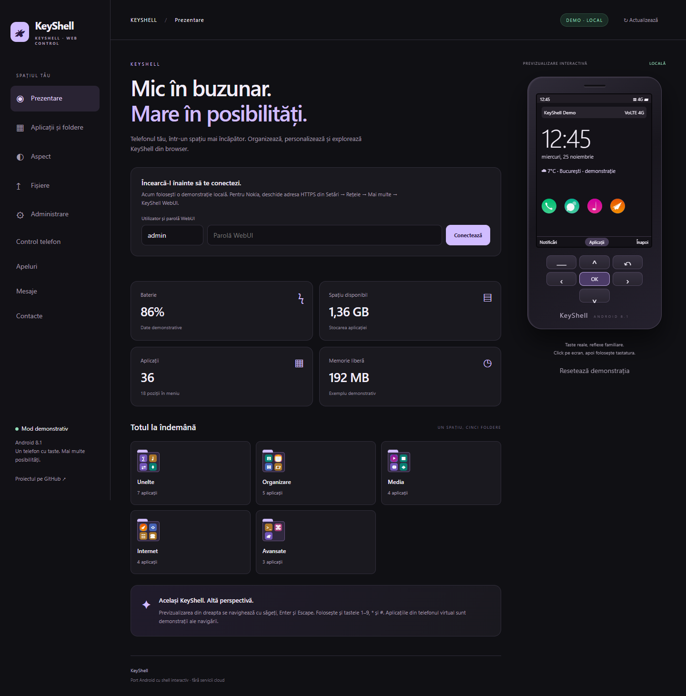
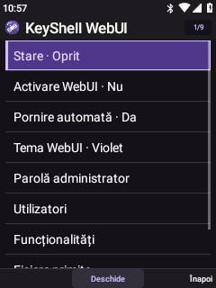
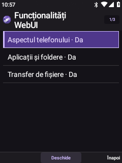

# KeyShell WebUI · 26 November 2026

A responsive browser interface with an offline phone demo and an authenticated
control panel for the real Nokia. **KeyShell** is the shell name; **N0d3** is the
wider project. The demo illustrates navigation; it does not run Android apps,
make calls or send messages.

**26 November:** the connected WebUI now also provides a real screen and keypad,
app launching, Unicode paste, cellular call controls, recent calls, SMS reading/
composition and contacts. These are separate from the virtual phone demo and
require an administrator plus the relevant native feature switches.
See [remote-control guide and fresh evidence](WEBUI-CONTROL.md).



## Use the real phone

1. Connect the PC and Nokia to the same Wi-Fi network.
2. Open **Applications → Advanced → WebUI** on Nokia. The existing
   **Settings → Networks → More → KeyShell WebUI** entry also works.
3. Create an administrator and password if this is a new installation, then enable
   WebUI. Its first row displays the complete **HTTPS address**, including the
   phone's Wi-Fi IP and port **18764**. Open that address on the PC.
4. At first connection, compare the browser's certificate SHA-256 fingerprint
   with **Address WebUI** on Nokia before accepting the local certificate.
   Each installation has its own self-signed identity; investigate any mismatch.
5. Sign in with a username and password. Change your password from
   **Administrare → Parola mea**, or reset it from the native phone controls.

There is no factory password in the source. The project handset's owner supplied
its initial password privately. Passwords and account snapshots are not published.

WebUI remains enabled in a visible **foreground service**, without the former
15-minute limit. Closing its phone page or the PC browser leaves the service
running. It waits for Wi-Fi when offline and binds again when the address returns
or changes. The phone page shows the current address. A small **satellite and
green dot** on the dashboard indicates a live HTTPS listener.

**Automatic startup** controls boot/package-update startup. Android may restart
the sticky service after reclaiming its process; Home also resumes an owner-enabled
service. **Disable WebUI** or the notification's **Stop** action persists the off
state. Availability still depends on Wi-Fi, Android scheduling and the phone being
awake enough to answer; persistent operation does not mean a CPU wake lock.

| Native controls · real phone | Feature controls · real phone |
| :---: | :---: |
|  |  |

## Controls and accounts

The native **WebUI** app supports enable/disable, automatic startup, browser theme,
administrator password reset, users, feature switches, received files and the
existing package/rollback page. It works without a PC or active listener.
Forms use the existing keypad, masked passwords and confirmation fields.

Browser **Administrare** adds three WebUI themes (**Violet, Graphite, Ocean**),
startup and feature controls, password changes and user management. The WebUI
theme is independent of the phone's global theme.

- Up to **eight users**: administrator or read-only viewer. Viewers can change
  their own password; account management and settings writes require an administrator.
- The final administrator cannot be removed. Resetting a password or removing a
  user invalidates their sessions. Own-password change issues a replacement token
  for the current browser.
- Appearance, app/folder layout and file exchange have separate switches, enforced
  by the server as well as the browser. Their saved settings survive restarts.
- Connected changes use explicit save buttons. Home observes folder changes and
  redraws without restarting. Existing app IDs, shortcuts and per-app themes remain.

Connected status covers battery/charging, memory, storage and shell health.
The separate **Control telefon, Apeluri, Mesaje and Contacte** pages provide the
authorized phone controls. There is no arbitrary shell-command API or remote
package-install endpoint. Call audio remains on Nokia.

## Passwords, sessions and network boundary

Passwords use **bcrypt cost 10**, from the already bundled library, with unique
salts and private app storage. The range is at least eight characters and at most
**72 UTF-8 bytes**, with NUL rejected. Password work runs outside the UI thread
and the preference-store lock. PBKDF2-SHA256 at 600,000 iterations was tried on
this Nokia and exceeded 20 seconds; it is not the deployed verifier. This legacy
choice follows the [OWASP bcrypt guidance](https://cheatsheetseries.owasp.org/cheatsheets/Password_Storage_Cheat_Sheet.html#bcrypt).

Login creates a random 128-bit bearer token held only in server/browser memory.
Tokens expire after **12 hours**, with at most 16 sessions. Five failed login or
current-password attempts cause a 60-second cooldown. Logout invalidates its token.
Passwords/tokens are never placed in URLs, browser local/session storage or cookies.
Service-process restart clears sessions, requiring sign-in again.

Production listens only on the phone's **Wi-Fi IPv4 address**, using TLS 1.2,
ECDHE-RSA/AES-GCM and its AndroidKeyStore certificate. The private key and password
verifiers are excluded from the general settings backup. No router forwarding or
public Internet access is configured. Loopback token constructors remain only for
compatibility tests. Public API information contains the login-page theme, not
phone status or accounts. Host/Origin checks, fixed asset paths and a bundled-only
Content Security Policy remain enforced.

Only `files/documents/Companion` is shared. Files use bounded ASCII names, a
**16 MiB** transfer limit and a maximum 64-entry listing. Existing files are never
replaced: staged, synced uploads are published under a shared lock; concurrent
same-name requests produce one 201 and one 409. Interrupted staging is removed.
The service has two workers, four queued requests and five-second socket deadlines.
Stopping closes accepted sockets and the listener. Network changes use callbacks;
there is no production wake lock or periodic status poll. Binding errors alone
schedule a 30-second retry.

## Offline demo

```text
python android81/serve-webui-demo.py
```

Open <http://127.0.0.1:18766/webui/>. The same plain HTML/CSS/JS assets can be
opened locally with their parent icon directory. No npm, external font, cloud
account or analytics is needed. Example time, weather, networks and statistics
are synthetic. Demo choices stay under `keyshell-demo-v1` in that browser.

Click the virtual screen, then use arrows, Enter and Escape. Digits 1–9 choose
a position; `*`, `#` and `0` change pages. Back follows app → folder → menu →
dashboard. Each folder retains its selection. On-screen controls also work.

| Appearance preview | Folder organization preview |
| :---: | :---: |
|  |  |

## Build and verification

`catalog.js` is regenerated from `AppCatalog`, `LauncherFolders` and `Appearance`.
It contains public defaults and synthetic statistics, never daily phone data.
The catalog has **50 stable destinations: 36 launcher and 14 contextual**.
WebUI is appended at **ID 49**, in Advanced; old IDs 0–48 remain stable.

```text
python android81/build-webui-demo.py
python android81/build-pocket-apps-windows.py
python android81/build-pocket-tests-windows.py --webui-access
python android81/test-webui-browser.py
python -m unittest discover -s android81/tests -q
```

25 November password/persistence evidence from TA-1286/API 27, starting at `ba0bf51`:

- **66 native checks** passed: password/role boundaries, reset/token revocation,
  last-admin protection, throttling, strict payloads, feature gates, native controls,
  real Wi-Fi service binding/rebinding, explicit off, immediate stop, pending-listener
  cleanup and Home updates. Test preferences were restored. The boot receiver was
  invoked under controlled preferences; no physical reboot was performed.
- **34 Edge browser checks** passed using an isolated, certificate-pinned on-phone
  fixture: responsive demo, 36 apps/five folders, appearance/layout, files,
  administrator/viewer behavior and password rotation. Fixture accounts are separate
  from the owner's account.
- **107 host checks**, catalog/manifest and signed-APK compatibility audits passed.
  The shell compiles **304 production Java sources**; **2,306 candidate classes**
  preserve all 431 baseline external classes.
- The actual owner account was provisioned privately. A separate, pinned HTTPS
  login/status/logout request from the PC over real Wi-Fi passed. The permanent
  service remains enabled on the project handset.

25 November **data APK** SHA-256 (superseded by the [remote-control build](WEBUI-CONTROL.md)):
`bbd470494c94e5b4fb6466670e46b7252407c7d5da3b12517478cda488584b70`.
Bundled **system base**, unchanged:
`abcb93b6ee1305ededb7e52105a2d5dc232f8c795e67420834e49564cb89f0e6`.
No ROM flash or system promotion was performed. Previous APK/preferences and
sanitized reports remain under ignored `output/webui-persistent/`.

Battery/deep-sleep response, long uptime and different router configurations still
need their own trials. The virtual phone remains a demo; **Control telefon** is
the real screen/keypad interface. See the [automated keySIP call check](KEYSHELL-NETWORK-SIP.md#keysip-follow-up--25-november-2026).
