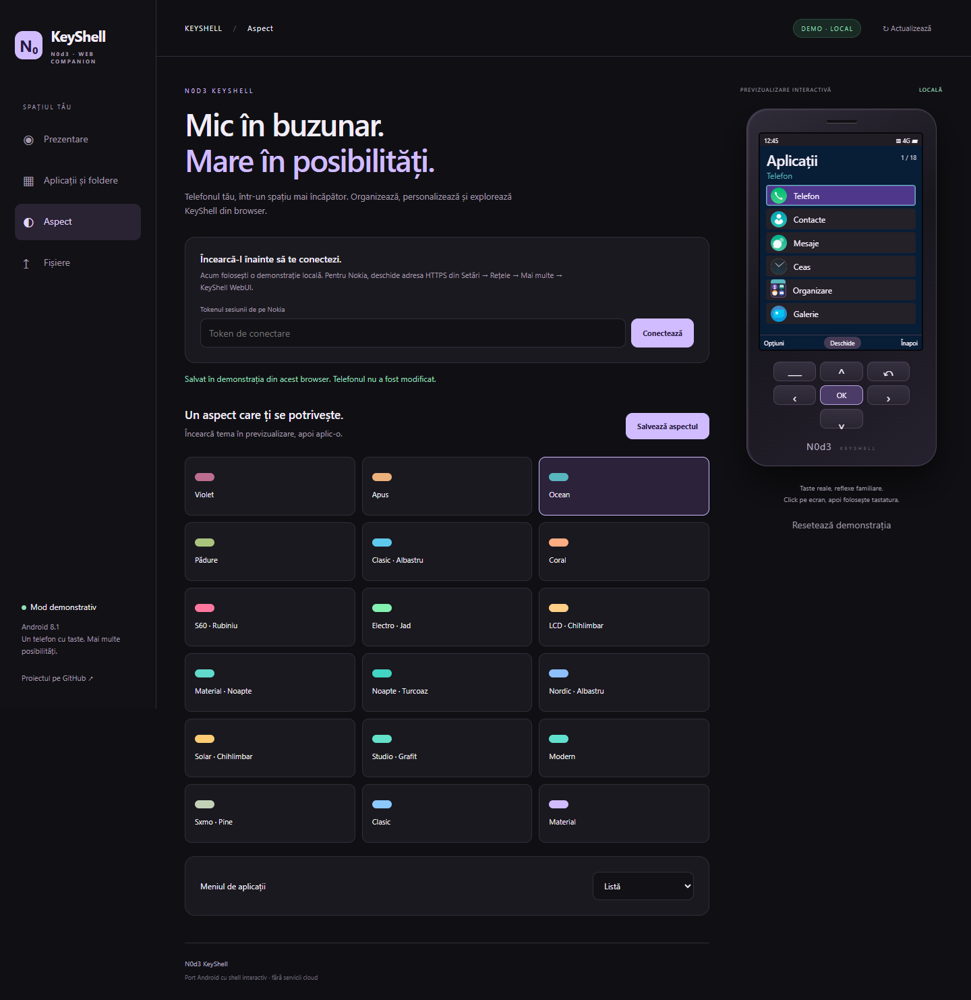
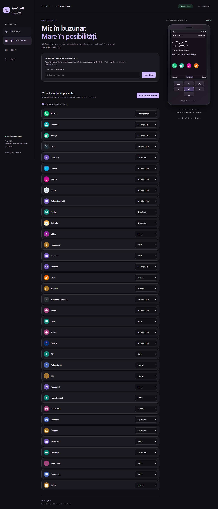
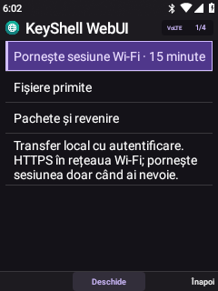

# N0d3 KeyShell WebUI · 25 November 2026

One lightweight browser interface, with two distinct modes:

- **Offline demo:** a navigable KeyShell phone, folders, theme and grid/list
  previews. Changes stay in this browser. The app screens demonstrate navigation;
  they do not run Android apps, calls or messaging.
- **Connected Nokia:** real battery, charging, memory, storage and shell-health
  information; launcher-folder assignments; global theme and grid/list settings;
  upload/download inside the existing Companion exchange folder.

The preview stays a simulation even while connected. This version does not stream
the screen or remotely press keys, launch apps, execute commands, send messages,
read contacts or install received packages.


## Try the demo

```text
python android81/serve-webui-demo.py
```

Open <http://127.0.0.1:18766/webui/> on this PC. Alternatively, open
`android81/visual-shell/assets/webui/index.html` directly, retaining its parent
asset directory for the bundled Gaia icons. No npm build, external fonts,
analytics, cloud account or network connection is needed.

Click the virtual screen, then use arrows, Enter and Escape. Digits 1–9 select a
position; `*` / `#` and `0` change pages. On-screen buttons work too. Back returns
through app → folder → main menu → dashboard. Each folder retains its selection.
The demo's example time, weather, network and device statistics are labeled;
layout/theme choices are stored locally under `keyshell-demo-v1`.

## Connect the real Nokia

1. Connect the PC and Nokia to the same Wi-Fi network.
2. On Nokia, open **Settings → Networks → More → KeyShell WebUI**.
   Studio provides the same entry.
3. Start the 15-minute session. Open the displayed **HTTPS** address on the PC.
4. On the first connection, compare the browser's certificate SHA-256 fingerprint
   with the fingerprint displayed on Nokia, then accept this local certificate.
   This is a per-install self-signed identity, so normal public-website trust is
   unavailable. Never bypass a fingerprint mismatch.
5. Enter the session token from Nokia. The badge changes to **NOKIA · CONECTAT**.

Use **Apply on Nokia** to save layout or appearance changes. Preview edits are not
applied automatically. Home observes the folder preferences and coalesces bulk
changes into one redraw, so a visible menu refreshes without restarting the shell.
Per-app theme overrides, app IDs, existing order and shortcuts remain intact.
The API cannot alter simple/full mode.

Stop the session from Nokia's left softkey or notification. It also stops after
15 minutes or when the Wi-Fi address disappears/changes. It never starts at boot,
holds no production wake lock and performs no background polling. The PC page
refreshes device data on request. Reopening the page requires the token again;
the token is kept in memory, cleared from the input after connection, never placed
in URLs, cookies, local storage or session storage.

## Transfer boundary

Only `files/documents/Companion` is shared. Uploads are limited to 16 MiB, with
simple ASCII filenames up to 80 characters. Existing files are never replaced.
Each upload is staged and synced; publication checks and rename are serialized
across server instances. Concurrent uploads of the same name produce one 201 and
one 409. Interrupted staging files are removed. The file list is capped at 64
entries; this version does not delete or install files remotely.

Production uses TLS 1.2 with ECDHE-RSA/AES-GCM and an AndroidKeyStore identity.
The key is not exported or included in preference backups. HTTP construction is
limited to loopback compatibility tests. Host and Origin must match the bound
address. APIs require the session token; public routes expose only fixed WebUI
assets and bundled icon names. CSP permits bundled scripts/styles and forbids
inline/eval scripts, embedding and object content. The server has two workers,
four queued requests, five-second socket deadlines and bounded headers/bodies.
Stopping it closes accepted sockets as well as the listener.

Key generation and TLS setup run off the UI thread. The existing settings backup
already covers appearance and the `launcher-folders` group. API payloads accept
only the exact documented fields, validate the whole payload before writing,
and commit each settings group independently.

## Source and regeneration

`visual-shell/assets/webui/` contains plain HTML, CSS and JavaScript shared by both
modes. `catalog.js` is generated from `AppCatalog`, `LauncherFolders` and
`Appearance`; it contains public defaults and synthetic statistics, never a
snapshot of user data. The Windows builder regenerates it automatically.
`CompanionModel` owns the small API surface; `CompanionTls` owns certificate setup.
Companion's existing session lifecycle, exchange folder and package names remain.

```text
python android81/build-webui-demo.py
python android81/build-pocket-apps-windows.py
python android81/build-pocket-tests-windows.py --webui
python android81/test-webui-browser.py
python -m unittest discover -s android81/tests -q
```

## Fresh validation

Starting revision: `2f1a898`, TA-1286 / API 27.

- **38 device checks:** pinned TLS, public assets, token/Origin rejection, strict
  settings validation, all 35 apps/five folders, concurrent uploads, download
  equality, staging cleanup, actual Home updates without restart and preference
  restoration. The production service also started, answered authenticated status
  through its actual Wi-Fi binding and stopped. Immediate stop also closes a
  pending TLS listener and cannot publish a late session. No real call/message was made.
- **28 browser checks in Edge:** desktop/mobile demo, all bundled icons, folder
  and return focus, keyboard input, local persistence, theme/list previews,
  responsive layout, connected saves, upload/download byte equality, token
  handling and disconnect. The connected browser used an isolated on-phone TLS
  fixture over an explicit USB forward, with its certificate pinned before token
  use. Its settings/files were separate from daily phone data.
- **107 host tests**, catalog/manifest audit and signed-APK dependency audit passed.
  300 production Java sources compiled; 2,284 classes in the candidate preserve all
  431 baseline external dependency classes. There are still 49 stable destinations.
- Standard physical Home/Menu/Settings smoke checks passed. Screenshots of the
  desktop/mobile interface contain public demo data only; the phone entry image
  shows the stopped session, with no token or network address.

The running **data APK** has SHA-256
`be5fe543b477053aef0a88267780f44127deb368c5a0039b5b07709d72b59f5f`.
The bundled system APK remains
`abcb93b6ee1305ededb7e52105a2d5dc232f8c795e67420834e49564cb89f0e6`.
No ROM flash or system promotion was performed. The prior signed APK and local
preference snapshot are retained under ignored `output/webui/`.

The automatic 15-minute deadline is wired and inherited from Companion; this batch
does not claim a new full-duration expiry or battery trial. PC-to-Nokia access on
every Wi-Fi/router configuration remains unverified. External email/SSH/feed
providers and remote display/input remain separate work.

| Appearance | App organization | Nokia entry |
| :---: | :---: | :---: |
|  |  |  |

TLS implementation follows the platform's [KeyGenParameterSpec contract](https://developer.android.com/reference/android/security/keystore/KeyGenParameterSpec)
and [SSLServerSocket protocol configuration](https://developer.android.com/reference/javax/net/ssl/SSLServerSocket).
