# Archived README gallery · 6 November 2026

## Screenshots

**Leo Modern UI foundation (28 October):** navy/teal shared chrome, clearer focus
and softkeys, and native SystemUI with a left clock. The 31 October update hides
numeric SIM-slot labels to avoid collisions with the LTE/4G indicators.
Installed on the development phone; the published ROM ZIP still predates it.
[Design, build and validation](../../../android81/LEO-MODERN-UI.md).

**Home customization (31 October):** an [on-device Home editor](../../../android81/HOME-EDITOR.md)
adds movement, sizing, item rotation, alignment, visibility and reset controls.
Home and the global menu now open Android's notification shade. Phone/Messages
use unread dots, replacing the permanent SMS/missed-call summary row.
The [dashboard follow-up](../../../android81/DASHBOARD-WAKE.md) adds cached-condition
weather symbols, separate editable SIM icon rows, removes Home dBm text, and
enables display wake from built-in keypad keys.

| Leo Modern Home | Shared settings chrome | System bar over Android Settings |
| :---: | :---: | :---: |
| 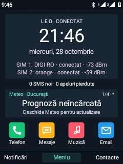 | 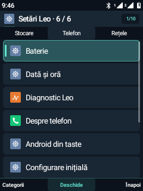 | 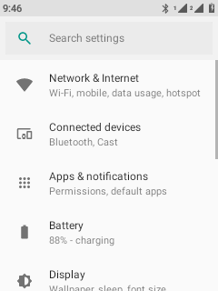 |

Real phone captures retain the language selected when taken. Leo supports
English and Romanian. Older call screens below are **local demos**, not live calls.

| Clean-install Home | App menu | Global menu over Android Settings |
| :---: | :---: | :---: |
| 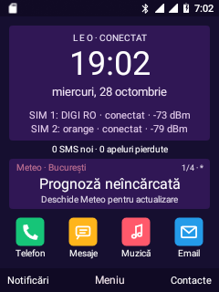 | 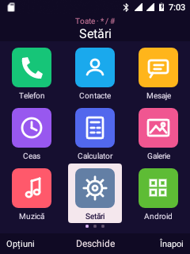 | 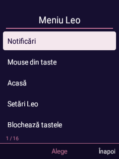 |

| Native recovery | Installation complete | Leo Night incoming-call demo |
| :---: | :---: | :---: |
| 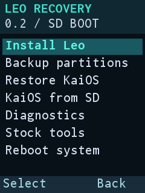 | 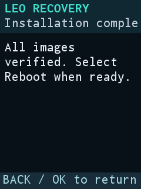 | 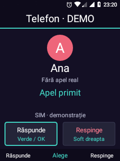 |

| Music player preview | Clock | PDF reader |
| :---: | :---: | :---: |
| 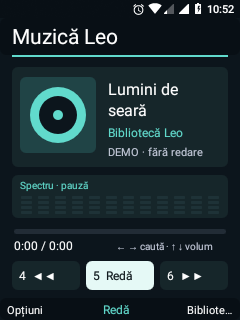 | 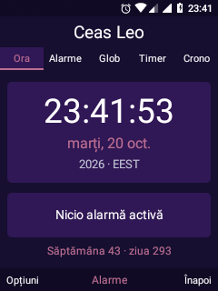 | 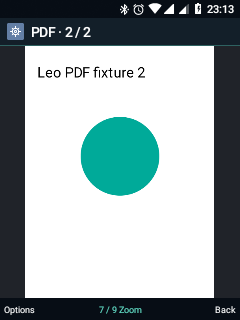 |
