# Leo Visual screen atlas · 13 November 2026

111 captures from the 240 × 320 Nokia 6300 4G development phone.
The phone ran Leo Visual 0.14.0-dev with its Romanian interface. Home shows a
single installed SIM in slot 2. The call and Current Media examples are demos.
Selected rows with local identifiers or filenames were masked.

[Detailed atlas · 44 additional screens](extended/README.md) ·
[Detailed atlas · 45 additional screens](extended/README.md) ·
[Detailed atlas · 48 additional screens](extended/README.md) ·
[Project README](../../../README.md) · [Technical audit](../../../android81/PROJECT-AUDIT-2026-11-13.md) ·
[Earlier gallery](../2026-11-06/README.md)

## Home and launcher

| Home · one installed SIM | Universal Menu | Apps · Primary |
| :---: | :---: | :---: |
| <a href="home.png">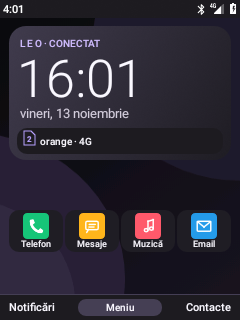</a> | <a href="global-menu.png">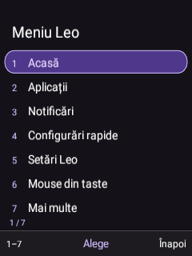</a> | <a href="apps-cycle-1.png">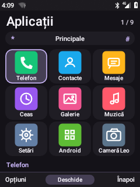</a> |

| Apps · Communication | Apps · Media | Apps · Tools |
| :---: | :---: | :---: |
| <a href="apps-cycle-2.png">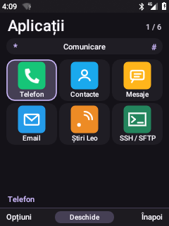</a> | <a href="apps-cycle-3.png">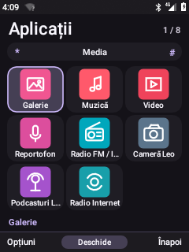</a> | <a href="apps-cycle-4.png">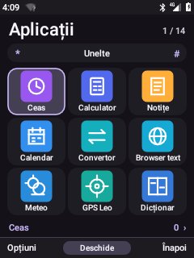</a> |

| Apps · Leisure | Apps · System | Apps · All |
| :---: | :---: | :---: |
| <a href="apps-cycle-5.png">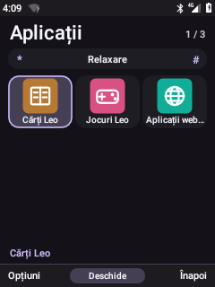</a> | <a href="apps-cycle-6.png">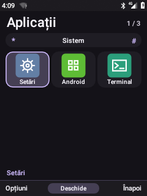</a> | <a href="apps-cycle-7.png">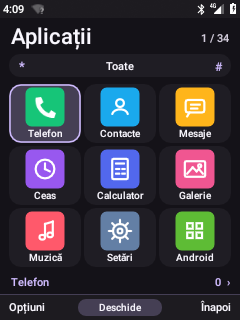</a> |

| App menu options | Application order | Application reorder actions |
| :---: | :---: | :---: |
| <a href="apps-options.png">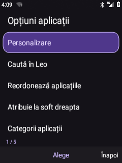</a> | <a href="app-order.png">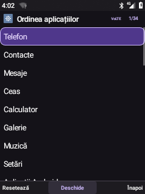</a> | <a href="app-order-actions.png">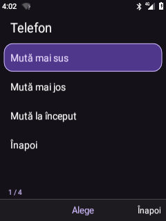</a> |

| Home editor · individual SIM positions | Home card selection and order | Global search |
| :---: | :---: | :---: |
| <a href="home-editor.png">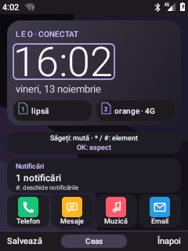</a> | <a href="home-card-order.png">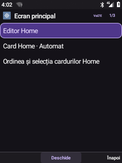</a> | <a href="search.png">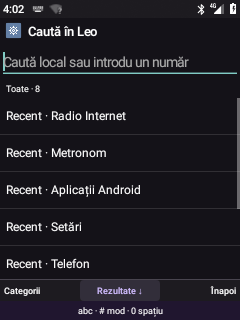</a> |

| Quick access | Quick Settings | Separate volume controls |
| :---: | :---: | :---: |
| <a href="quick-home.png">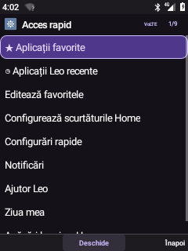</a> | <a href="quick-settings.png">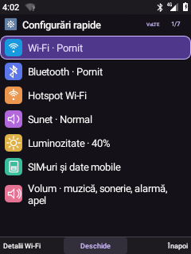</a> | <a href="volumes.png">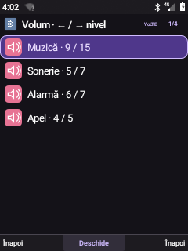</a> |

| Power menu |
| :---: |
| <a href="power-menu.png">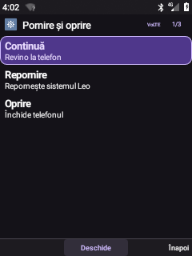</a> |

## Settings categories

| Settings · Networks | Settings · Appearance | Settings · Sound |
| :---: | :---: | :---: |
| <a href="settings-networks.png">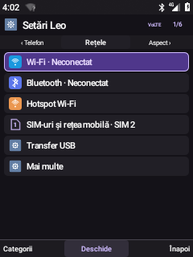</a> | <a href="settings-appearance.png">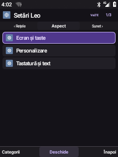</a> | <a href="settings-sound.png">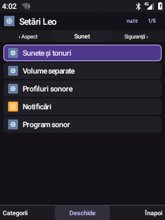</a> |

| Settings · Safety | Settings · Storage | Settings · Phone |
| :---: | :---: | :---: |
| <a href="settings-safety.png">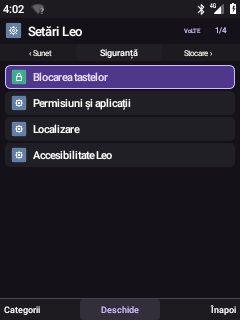</a> | <a href="settings-storage.png">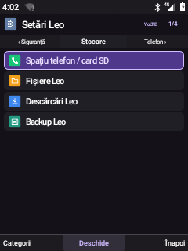</a> | <a href="settings-phone.png">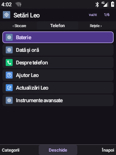</a> |

| Settings category picker |
| :---: |
| <a href="settings-category-picker.png">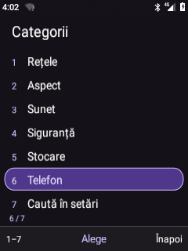</a> |

## Settings submenus

| Wi-Fi settings · redacted | Bluetooth settings | SIM and mobile network |
| :---: | :---: | :---: |
| <a href="wifi.png">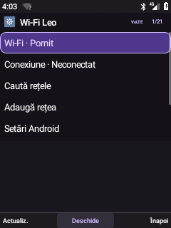</a> | <a href="bluetooth.png">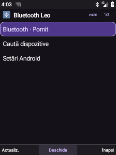</a> | <a href="mobile.png">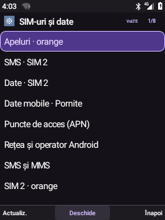</a> |

| USB transfer | Connections dashboard | Display and keys |
| :---: | :---: | :---: |
| <a href="usb.png">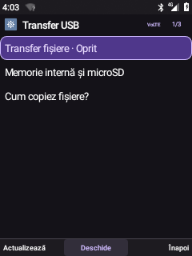</a> | <a href="connections.png">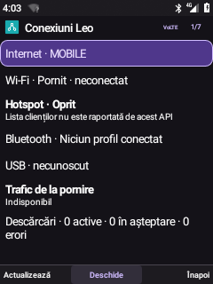</a> | <a href="display.png">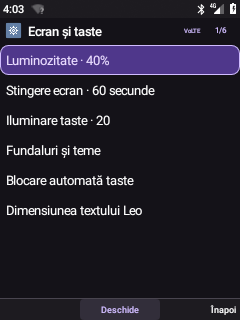</a> |

| Personalization groups | Keyboard and text | Sounds and tones |
| :---: | :---: | :---: |
| <a href="personalization.png">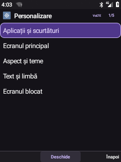</a> | <a href="input.png">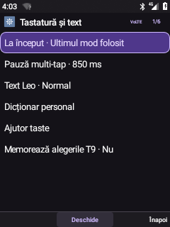</a> | <a href="sounds.png">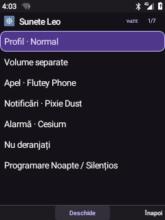</a> |

| Notification settings | Sound schedule | Keypad lock settings |
| :---: | :---: | :---: |
| <a href="notice-settings.png">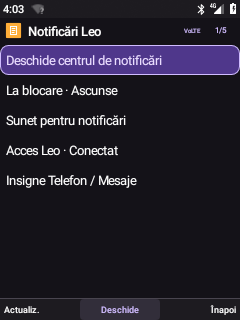</a> | <a href="sound-schedule.png">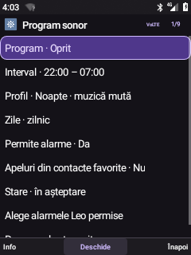</a> | <a href="lock-settings.png">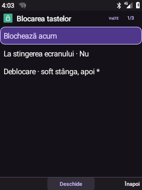</a> |

| App permissions | Location settings | Leo accessibility |
| :---: | :---: | :---: |
| <a href="permissions.png">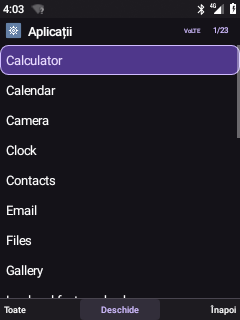</a> | <a href="location.png">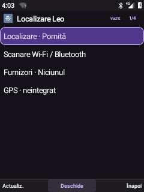</a> | <a href="accessibility.png">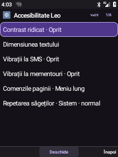</a> |

| Storage and SD | Battery | Date and time |
| :---: | :---: | :---: |
| <a href="storage.png">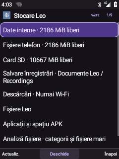</a> | <a href="battery.png">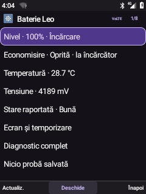</a> | <a href="date-time.png">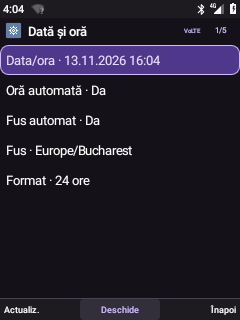</a> |

| Updates and rollback | Android keypad controls | Theme packs |
| :---: | :---: | :---: |
| <a href="updates.png">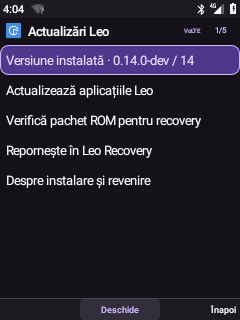</a> | <a href="android-controls.png">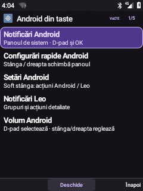</a> | <a href="theme-packs.png">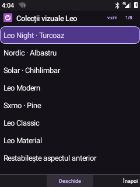</a> |

| Interface language | Visual profiles | Leo help |
| :---: | :---: | :---: |
| <a href="language.png">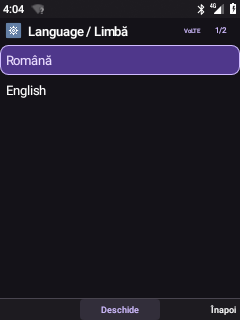</a> | <a href="visual-profiles.png">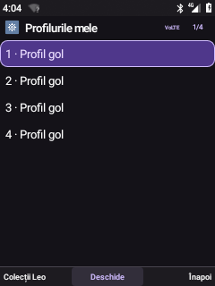</a> | <a href="help.png">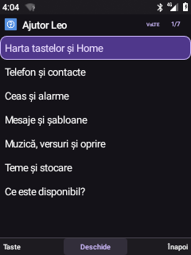</a> |

| Android Settings · dark mode | Application shortcuts · submenu | Home layout · submenu |
| :---: | :---: | :---: |
|  |  |  |

| Themes · submenu | Text and language · submenu | Lock screen · submenu |
| :---: | :---: | :---: |
|  |  |  |

| Hotspot controls · redacted | Files · entry point | Downloads center |
| :---: | :---: | :---: |
|  |  |  |

| Leo diagnostics | Backup categories |
| :---: | :---: |
|  |  |

## Media and organizer

| Radio · FM tuner | Radio · Internet directory | Radio Internet options |
| :---: | :---: | :---: |
|  |  |  |

| Music library | Current Media | Music player |
| :---: | :---: | :---: |
|  |  |  |

| Clock · time | Clock · Alarms | Clock · World |
| :---: | :---: | :---: |
|  |  |  |

| Clock · Timer | Clock · Stopwatch | Calculator |
| :---: | :---: | :---: |
|  |  |  |

| Converter | Recorder controls | GPS controls |
| :---: | :---: | :---: |
|  |  |  |

| Games menu | Reader library |
| :---: | :---: |
|  |  |

## Communication and Pocket apps

| Phone keypad | Phone options | RSS and Atom |
| :---: | :---: | :---: |
|  |  |  |

| Podcasts | RO–EN dictionary | Study cards |
| :---: | :---: | :---: |
|  |  |  |

| ZIP tools | Expenses | Metronome controls |
| :---: | :---: | :---: |
|  |  |  |

| QR tools | Installed Web apps | Android app drawer |
| :---: | :---: | :---: |
|  |  |  |

| Text browser | Leo Studio | Companion controls |
| :---: | :---: | :---: |
|  |  |  |

## Application submenus

| Messages folders | Messages options | Contacts list |
| :---: | :---: | :---: |
|  |  |  |

| Contacts options | Notes list | Notes · editor |
| :---: | :---: | :---: |
|  |  |  |

| Gallery · album list · redacted | Calendar | Calendar options |
| :---: | :---: | :---: |
|  |  |  |

| Email accounts | SSH / SFTP | Camera diagnostics |
| :---: | :---: | :---: |
|  |  |  |

| Incoming-call screen · local demo | Weather | Call services |
| :---: | :---: | :---: |
|  |  |  |

| Leo notification center · redacted | Video · library entry · redacted | Music playlists |
| :---: | :---: | :---: |
|  |  |  |

## Capture boundaries

The overview and the [detailed atlas](extended/README.md) cover the launcher,
all six Settings tabs and the listed application flows. The
[technical audit](../../../android81/PROJECT-AUDIT-2026-11-13.md) tracks scenarios that require
live accessories, personal records or dedicated hardware trials.
