# Leo Visual screen atlas · Detailed screens

48 additional 240 × 320 captures from the Nokia 6300 4G running Leo Visual 0.14.0-dev in Romanian.
Form fields are blank or show app defaults. Empty lists are shown as they appeared on the development phone.
Theme previews and any screenshots marked as demos use sample content built into Leo.

[Overview atlas](../README.md) · [Project README](../../../../README.md) ·
[Technical audit](../../../../android81/PROJECT-AUDIT-2026-11-13.md)

## Home and navigation

| Home card list | Move or hide a Home card | Recent pages and workspace |
| :---: | :---: | :---: |
| <a href="home-card-list.png">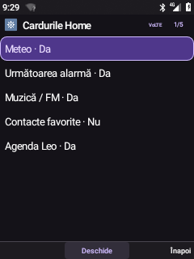</a> | <a href="home-card-actions.png">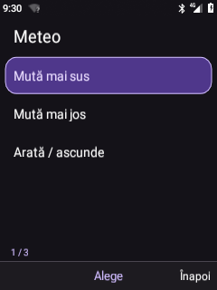</a> | <a href="workspace.png">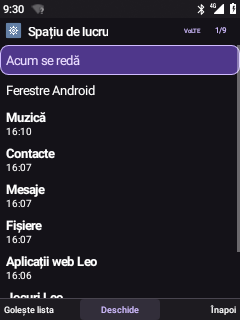</a> |

| Contextual keypad help | Launcher category picker | Home shortcut app picker |
| :---: | :---: | :---: |
| <a href="context-help.png">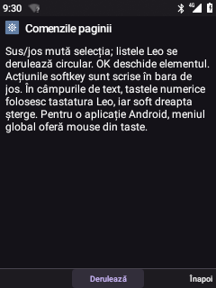</a> | <a href="launcher-category-picker.png">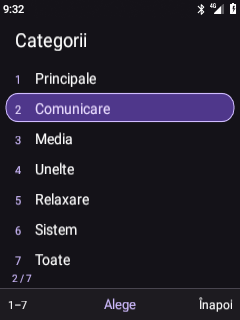</a> | <a href="home-app-picker.png">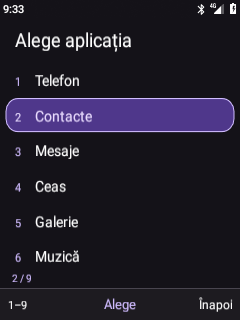</a> |

| Home long-press shortcuts | Leo controls in Android Settings |
| :---: | :---: |
| <a href="home-long-press.png">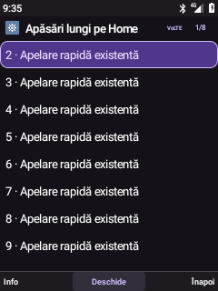</a> | <a href="global-in-android.png">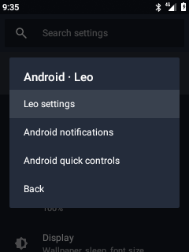</a> |

## Personalization

| Theme preview · Home | Theme preview · launcher | Theme preview · player |
| :---: | :---: | :---: |
| <a href="theme-home.png">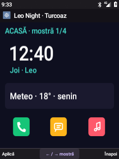</a> | <a href="theme-menu.png">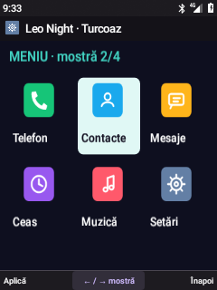</a> | <a href="theme-player.png">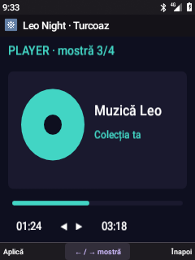</a> |

| Theme preview · lock screen |
| :---: |
| <a href="theme-lock.png">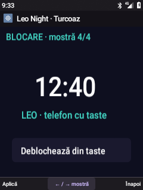</a> |

## System tools

| App management actions | App permission status | Bluetooth transfer history |
| :---: | :---: | :---: |
| <a href="app-details.png">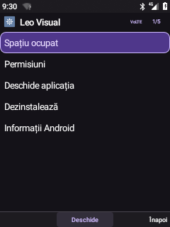</a> | <a href="app-permissions.png">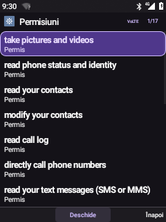</a> | <a href="bluetooth-transfers.png">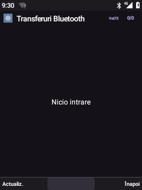</a> |

| Terminal at idle | Device readiness | Recovery center inside Leo |
| :---: | :---: | :---: |
| <a href="terminal.png">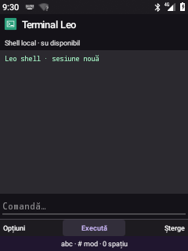</a> | <a href="readiness.png">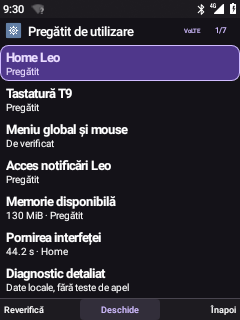</a> | <a href="recovery-center.png">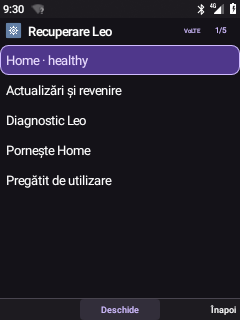</a> |

| Local automation rules | Automation trigger picker | Automation action picker |
| :---: | :---: | :---: |
| <a href="automations.png">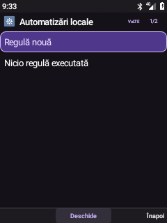</a> | <a href="automation-trigger.png">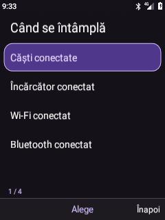</a> | <a href="automation-action.png">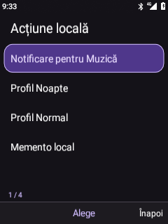</a> |

## Phone and contacts

| Call history | Call history filters | Call statistics |
| :---: | :---: | :---: |
| <a href="phone-history.png">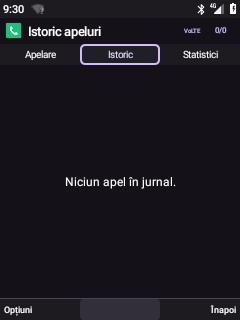</a> | <a href="phone-history-options.png">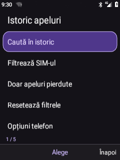</a> | <a href="phone-stats.png">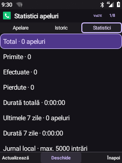</a> |

| Speed-dial assignments | Contact groups | vCard import and export |
| :---: | :---: | :---: |
| <a href="speed-dial.png">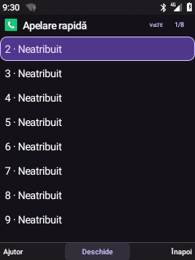</a> | <a href="contact-groups.png">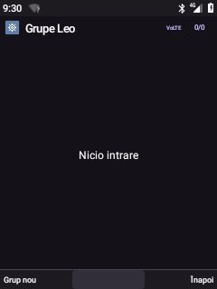</a> | <a href="vcf.png">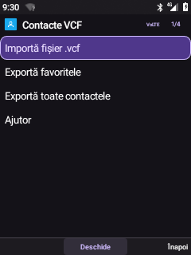</a> |

## Messages and email

| Blank SMS composer | SMS and MMS transport status | Blank email composer |
| :---: | :---: | :---: |
| <a href="sms-compose.png">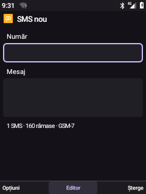</a> | <a href="sms-transport.png">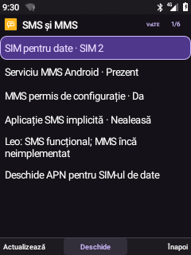</a> | <a href="email-compose.png">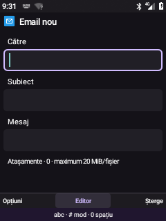</a> |

## Music and radio

| FM tuner options | FM scan results · empty | FM favorites · empty |
| :---: | :---: | :---: |
| <a href="fm-options.png">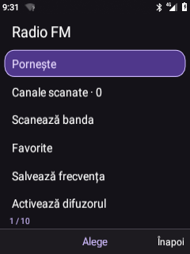</a> | <a href="fm-scanned.png">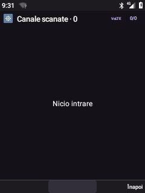</a> | <a href="fm-favorites.png">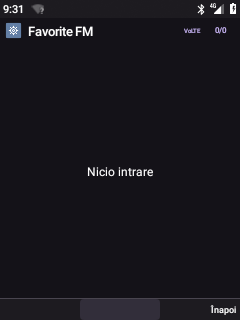</a> |

| Direct FM frequency entry | Internet radio favorites | Add an Internet radio station |
| :---: | :---: | :---: |
| <a href="fm-frequency.png">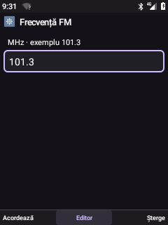</a> | <a href="radio-favorites.png">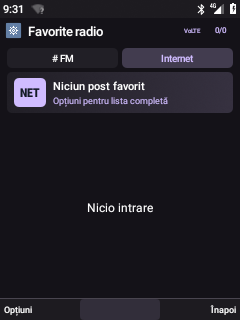</a> | <a href="radio-custom.png">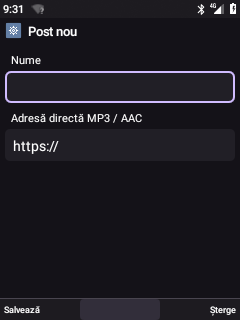</a> |

| Current Media options · demo | Current Media keypad reference · demo |
| :---: | :---: |
| <a href="current-media-options.png">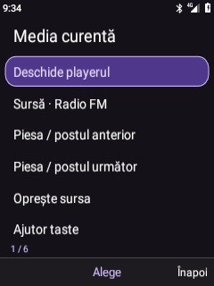</a> | <a href="current-media-help.png">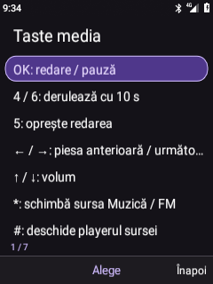</a> |

## Clock and calendar

| Alarm actions | World clock actions | Timer presets |
| :---: | :---: | :---: |
| <a href="alarm-options.png">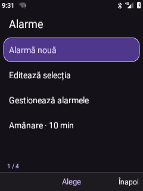</a> | <a href="world-options.png">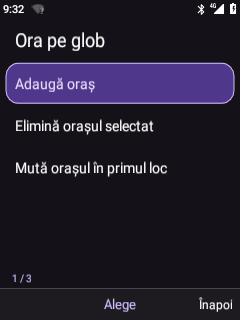</a> | <a href="timer-options.png">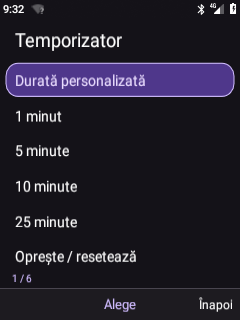</a> |

| Stopwatch actions | Calendar tools | Daily agenda |
| :---: | :---: | :---: |
| <a href="stopwatch-options.png">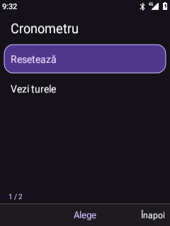</a> | <a href="calendar-tools.png">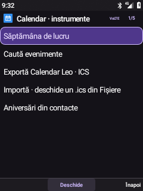</a> | <a href="daily-agenda.png">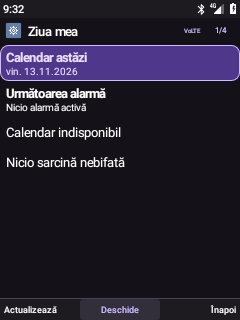</a> |

| Desk clock |
| :---: |
| <a href="desk-clock.png">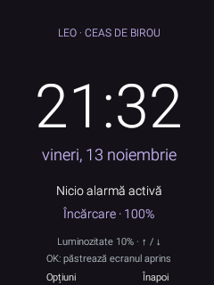</a> |

## Utilities

| GPS actions | Recorder actions | Calculator actions |
| :---: | :---: | :---: |
| <a href="gps-options.png">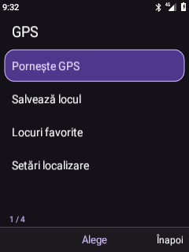</a> | <a href="recorder-options.png">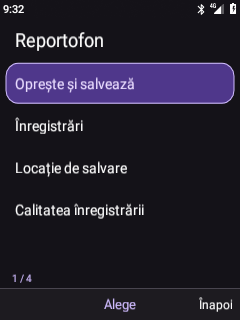</a> | <a href="calculator-options.png">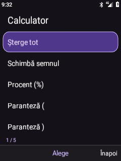</a> |
